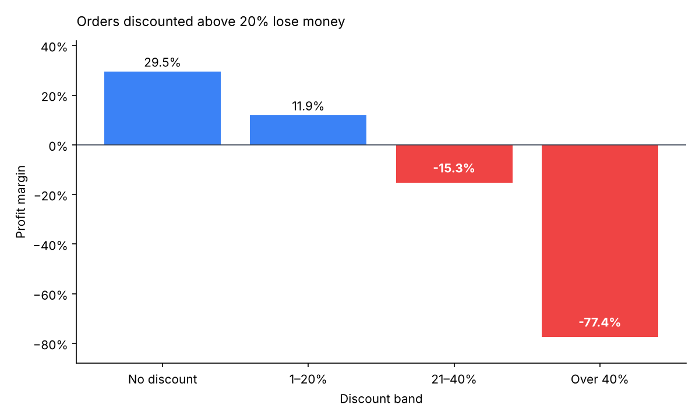

# Superstore Sales: Where Discounts Erase Profit

Exploratory data analysis of a US retail superstore's orders (9,977 order lines after removing 33 duplicates; $2.30M sales, $286K profit, 12.5% overall margin) to find which products, regions and pricing decisions drive profit and loss.

## Key findings

1. **Heavy discounting is the main source of losses.** Undiscounted orders earn a 29.5% margin. Orders discounted 21–40% lose 15.3%, and orders discounted above 40% lose 77.4%. Overall, 18.7% of order lines lose money.
2. **Furniture sells but barely profits.** Furniture brings in $741K of sales at a 2.5% margin, against about 17% for Technology and Office Supplies. Tables (−$17.7K) and Bookcases (−$3.5K) are the biggest loss-making sub-categories.
3. **Central is the weakest region.** Its margin is 7.9%, against 14.9% in the West and 13.5% in the East.
4. **A few states drag profit down.** Texas (−$25.8K), Ohio (−$17.0K) and Pennsylvania (−$15.6K) lose the most, while California ($76.3K) and New York ($74.0K) earn the most.

**Next step:** test capping discounts at 20% on Furniture and in the Central region, the two places where discounts and losses overlap most.

## Data and method

- `SampleSuperstore.csv`: 13 columns covering ship mode, segment, location, category, sales, quantity, discount and profit. No missing values.
- Cleaning: removed 33 duplicate rows and dropped Postal Code.
- Analysis: distributions, pair plots, and profit and sales broken down by segment, region, state, category, sub-category, discount and quantity.

## Limitations

The dataset has no order dates, so trends over time and seasonality can't be analysed. Discount and profit are recorded per order line, so the analysis can't separate the discount's effect from the product mix it was applied to.

## Files

- [`eda/Eda_Superstore.ipynb`](eda/Eda_Superstore.ipynb): full analysis with charts
- [`eda/SampleSuperstore.csv`](eda/SampleSuperstore.csv): dataset

**Tools:** Python, pandas, NumPy, Matplotlib, seaborn
